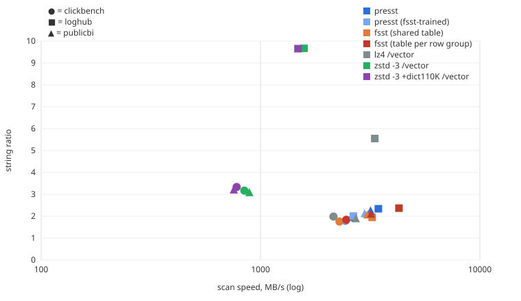

# Benchmarks

Two benchmarks:

1. **Database string columns** (main): 204 real string columns from three
   public datasets, stored the way column stores store them, with a strict
   separation between training and test data.
2. **dbtext blocks** (earlier, smaller): the FSST paper's corpus, cut into byte
   blocks. Kept at the end for reference.

# 1. Database string columns

## Question

presst trains its dictionary offline, once, instead of per block. The obvious
objection is *"of course it compresses well, you trained on the data you
compress."* This benchmark makes the training data an explicit axis: every
trained codec is measured with dictionaries trained at increasing distance
from the test data, always on the same training data for every codec.

## Data

Prepared by `cargo xtask data all`; every download is pinned by checksum in
`corpora/*.sources`.

| Dataset | Columns | Source | Train / test split |
|---|---:|---|---|
| ClickBench `hits` | 18 | 10 of 100 Parquet partitions | Rows ordered by `EventTime`: earliest half trains, latest half tests (0–354 h later). Level **L2** |
| Loghub | 13 | 13 system logs (Zenodo 8196385) | Chronological: first 25% of lines trains, the rest tests (up to 722 days later). Level **L2** |
| Public BI | 173 | Tables 1 and 2 of all 46 workbooks (first 24 MiB of each bzip2 file) | Table 1 trains, table 2 tests (**L3**, new table, same schema); single-table workbooks split rows in half (**L1**) |

Per column at most 64 MB of training and 64 MB of test data (evenly spread
samples); columns with fewer than 10,000 values or an average value under 4
bytes are skipped; per Public BI workbook the 5 largest string columns are
kept. NULL and empty values are dropped.

## Storage model

Like DuckDB: a column is split into **row groups of 122,880 values**, scanned
in **vectors of 2,048 values**. Every codec gets the same **dictionary layer**
per row group, as column stores do before string compression (DuckDB's
dictionary/FSST compression, Parquet's dictionary pages): the distinct values
are compressed, and each row stores a bit-packed index into them. Without this
layer, general-purpose compressors win mostly by removing duplicates, which no
real column store leaves to them.

- **Column ratio** = all values / (compressed distinct values + index).
- **String ratio** = distinct values / compressed distinct values: the string
  compression itself.
- **Scan**: decode every vector of distinct values. **Lookup**: fetch one random
  row (index, then value). Per-vector codecs must decompress a whole vector.

## Codecs

| Codec | Trained on | Unit |
|---|---|---|
| presst | the column's training data (extended trainer) | value |
| presst (fsst-trained) | the same, with FSST's own training algorithm | value |
| fsst (shared table) | the same, fsst-rs's trainer, one table per column | value |
| fsst (table per row group) | each row group itself (as DuckDB does); table stored per row group | value |
| lz4 /vector | – | vector of 2,048 distinct values |
| zstd -3 /vector | – | vector |
| zstd -3 +dict110K /vector | the column's training data (zstd dictionary, up to 110 KiB) | vector |

## Training levels

| Level | Dictionary trained on |
|---|---|
| L0 (oracle) | the test values themselves: an upper bound, never a headline |
| native (L1–L3) | the column's own training split (see Data) |
| L4 | same kind of data from other tables: Loghub leave-one-system-out, Public BI leave-one-workbook-out, ClickBench URL/text columns from the other datasets |
| L5 | a generic mix of all *other* datasets (never the one under test) |

A unit test checks that no L4 or L5 training set contains the column under
test. Dictionaries are published with the results (`--save-dicts`).

Machine: Intel Core i7-7740X (4.3 GHz), Windows, rustc 1.99.1, single thread,
median of 3 runs after a warm-up. Throughput is over distinct-value bytes.

Reproduce:

```sh
cargo xtask data all
cargo run --release -p presst-bench --bin presst-colbench -- --json main.jsonl --save-dicts dicts
cargo run --release -p presst-bench --bin presst-colbench -- --stress aging,sweep,matrix,mix --json stress.jsonl
cargo xtask colreport main.jsonl --svg chart.svg
cargo xtask colreport stress.jsonl
```

## What the results show

**1. Against FSST as databases use it** (a table per row group), presst
compresses the strings about 4% better (string ratio 2.20 vs 2.12 over all 204
columns) and **compresses 1.9× faster** (343 vs 181 MB/s), because it never
trains at ingest time. Point lookups are about as fast (43 vs 51 ns); full
scans are about 5% slower (3.1 vs 3.3 GB/s, fsst-rs's decoder).

**2. Against general-purpose compression per vector**, zstd compresses
about 2× better (string ratio 4.3), but scans 3× slower and a point lookup
takes about 19 µs instead of 43 ns (≈ 440×), because a whole vector must be
decompressed. LZ4 is close to presst in ratio and scan speed, with the same
lookup penalty.

**3. Training on the column's own past is enough.** At the native level
(older rows, or another table with the same schema) presst reaches 96–99% of
the oracle on ClickBench and Public BI, and 75% on logs, which drift.

**4. It is not memorization.** Removing every test value that occurs in the
training data changes presst's ratio no more than every other codec's. A
presst dictionary holds at most about 2 KB of substrings; zstd's up to 110 KB.
Across three disjoint thirds of the training data and three seeds, presst's
ratio varies by about 1%.

**5. More offline data pays off.** On the same 11 columns, presst's string
ratio grows from 1.63 with FSST's 16 KiB sample to 2.13 with 64 MiB of
training data (+31%).

**6. Generic dictionaries do not work.** Dictionaries trained on other tables
(L4) or other datasets (L5) reach only 41–57% of the oracle, for presst and
FSST alike, sometimes below 1.0 (worse than storing the strings raw). The
cross-column matrix shows the same: a dictionary only helps its own kind of
column. zstd dictionaries barely matter at all, because zstd mostly exploits
redundancy within a vector. **A presst dictionary must be trained per column
(or per very similar data), on that column's own history.**

**7. Dictionaries age.** For logs and click data, presst keeps up with FSST's
per-row-group retraining during the first weeks, then falls behind (beyond 180
days: 1.61 vs 3.18, few columns). Production use needs periodic retraining
and a check that falls back when the ratio drops.

## Caveats

- One machine, Windows, single thread; absolute speeds will differ elsewhere.
- FSST is fsst-rs; DuckDB's C++ FSST may be faster or slower.
- The age buckets contain different columns, so compare codecs within a
  bucket, not buckets with each other.
- Public BI workbooks Generico and Motos contain the same `Concatenar_2`
  column; for those two, leave-one-workbook-out (L4) is not a true holdout.
- Only the first 24 MiB of each Public BI file was used, so "table 1" and
  "table 2" are their first rows.
- Lookup latency for per-vector codecs is measured with a time budget per
  run (at least 256 lookups).



## Results

### Results at the native training level

Column ratio = all values / (compressed distinct values + index). String ratio = distinct values / compressed. Speeds are over the distinct values; lookups fetch one random row.

**clickbench** (18 columns)

| Codec | Column ratio | String ratio | Compress MB/s | Scan MB/s | Lookup | Shared dict |
|---|---:|---:|---:|---:|---:|---:|
| presst | 3.08 | 1.93 | 273 | 2650 | 45 ns | ≤ 1.6 KiB |
| presst (fsst-trained) | 2.85 | 1.78 | 250 | 2437 | 46 ns | ≤ 1.1 KiB |
| fsst (shared table) | 2.81 | 1.76 | 200 | 2291 | 42 ns | ≤ 0.9 KiB |
| fsst (table per row group) | 2.93 | 1.84 | 187 | 2461 | 47 ns | – |
| lz4 /vector | 3.15 | 1.98 | 358 | 2150 | 3.7 µs | – |
| zstd -3 /vector | 4.83 | 3.17 | 201 | 844 | 13.7 µs | – |
| zstd -3 +dict110K /vector | 5.06 | 3.33 | 170 | 779 | 11.7 µs | ≤ 110.0 KiB |

**loghub** (13 columns)

| Codec | Column ratio | String ratio | Compress MB/s | Scan MB/s | Lookup | Shared dict |
|---|---:|---:|---:|---:|---:|---:|
| presst | 2.38 | 2.34 | 453 | 3446 | 135 ns | ≤ 1.5 KiB |
| presst (fsst-trained) | 2.05 | 2.01 | 377 | 2651 | 153 ns | ≤ 1.3 KiB |
| fsst (shared table) | 1.99 | 1.95 | 290 | 3229 | 142 ns | ≤ 1.0 KiB |
| fsst (table per row group) | 2.41 | 2.37 | 308 | 4278 | 135 ns | – |
| lz4 /vector | 5.34 | 5.55 | 828 | 3318 | 83.1 µs | – |
| zstd -3 /vector | 8.73 | 9.67 | 524 | 1580 | 151.1 µs | – |
| zstd -3 +dict110K /vector | 8.71 | 9.65 | 405 | 1482 | 159.4 µs | ≤ 110.0 KiB |

**publicbi** (173 columns)

| Codec | Column ratio | String ratio | Compress MB/s | Scan MB/s | Lookup | Shared dict |
|---|---:|---:|---:|---:|---:|---:|
| presst | 7.77 | 2.23 | 314 | 3175 | 40 ns | ≤ 1.8 KiB |
| presst (fsst-trained) | 7.47 | 2.10 | 299 | 2985 | 42 ns | ≤ 1.4 KiB |
| fsst (shared table) | 7.34 | 2.05 | 177 | 3070 | 42 ns | ≤ 1.0 KiB |
| fsst (table per row group) | 7.43 | 2.09 | 131 | 3190 | 48 ns | – |
| lz4 /vector | 6.91 | 1.88 | 398 | 2721 | 5.8 µs | – |
| zstd -3 /vector | 9.45 | 3.07 | 192 | 889 | 17.1 µs | – |
| zstd -3 +dict110K /vector | 9.67 | 3.19 | 146 | 756 | 16.8 µs | ≤ 110.0 KiB |

**all** (204 columns)

| Codec | Column ratio | String ratio | Compress MB/s | Scan MB/s | Lookup | Shared dict |
|---|---:|---:|---:|---:|---:|---:|
| presst | 5.21 | 2.20 | 343 | 3136 | 43 ns | ≤ 1.8 KiB |
| presst (fsst-trained) | 4.81 | 1.99 | 310 | 2726 | 46 ns | ≤ 1.4 KiB |
| fsst (shared table) | 4.71 | 1.94 | 214 | 2914 | 45 ns | ≤ 1.0 KiB |
| fsst (table per row group) | 5.06 | 2.12 | 181 | 3297 | 51 ns | – |
| lz4 /vector | 5.83 | 2.54 | 480 | 2752 | 6.6 µs | – |
| zstd -3 /vector | 8.38 | 4.16 | 255 | 1050 | 19.3 µs | – |
| zstd -3 +dict110K /vector | 8.58 | 4.31 | 200 | 933 | 18.8 µs | ≤ 110.0 KiB |

### Training distance

String ratio of the trained codecs by how far their training data is from the test data. Gap = ratio / ratio at L0 (trained on the test data itself).

**clickbench**

| Codec | L0 (oracle) | native | L4 (other tables) | L5 (other datasets) |
|---|---:|---:|---:|---:|
| presst | 2.01 | 1.93 (96%) | 0.82 (41%) | 0.82 (41%) |
| fsst (shared table) | 1.84 | 1.76 (96%) | 0.82 (45%) | 0.82 (45%) |
| zstd -3 +dict110K /vector | 3.40 | 3.33 (98%) | 3.16 (93%) | 3.16 (93%) |

**loghub**

| Codec | L0 (oracle) | native | L4 (other tables) | L5 (other datasets) |
|---|---:|---:|---:|---:|
| presst | 3.10 | 2.34 (75%) | 1.35 (44%) | 1.22 (39%) |
| fsst (shared table) | 2.24 | 1.95 (87%) | 1.30 (58%) | 1.18 (53%) |
| zstd -3 +dict110K /vector | 9.62 | 9.65 (100%) | 9.68 (101%) | 9.68 (101%) |

**publicbi**

| Codec | L0 (oracle) | native | L4 (other tables) | L5 (other datasets) |
|---|---:|---:|---:|---:|
| presst | 2.25 | 2.23 (99%) | 1.23 (54%) | 1.20 (54%) |
| fsst (shared table) | 2.05 | 2.05 (100%) | 1.18 (57%) | 1.16 (57%) |
| zstd -3 +dict110K /vector | 3.21 | 3.19 (99%) | 3.09 (96%) | 3.08 (96%) |

### Duplicate control

String ratio on all test values vs. only test values that never occur in the training data.

| Dataset | Codec | All test values | Unseen values only |
|---|---|---:|---:|
| clickbench | presst | 1.93 | 1.92 |
| clickbench | fsst (shared table) | 1.76 | 1.74 |
| clickbench | fsst (table per row group) | 1.84 | 1.82 |
| clickbench | zstd -3 +dict110K /vector | 3.33 | 3.32 |
| loghub | presst | 2.34 | 2.34 |
| loghub | fsst (shared table) | 1.95 | 1.95 |
| loghub | fsst (table per row group) | 2.37 | 2.37 |
| loghub | zstd -3 +dict110K /vector | 9.65 | 9.66 |
| publicbi | presst | 2.23 | 1.92 |
| publicbi | fsst (shared table) | 2.05 | 1.78 |
| publicbi | fsst (table per row group) | 2.09 | 1.82 |
| publicbi | zstd -3 +dict110K /vector | 3.19 | 2.69 |

### Variance over training subsets and seeds (presst)

| Column | Full training set | 3 disjoint thirds, 3 seeds (min – max) |
|---|---:|---:|
| clickbench/hits/OriginalURL | 2.286 | 2.289 – 2.293 |
| clickbench/hits/Referer | 1.634 | 1.627 – 1.630 |
| clickbench/hits/Title | 2.003 | 1.995 – 2.001 |
| clickbench/hits/URL | 1.667 | 1.658 – 1.662 |
| loghub/BGL/line | 1.831 | 1.853 – 1.872 |
| loghub/HDFS/line | 3.195 | 3.111 – 3.251 |
| loghub/OpenSSH/line | 2.476 | 2.414 – 2.497 |
| loghub/Spark/line | 2.442 | 2.397 – 2.450 |
| publicbi/Generico/Concatenar_2 | 5.741 | 5.717 – 5.726 |
| publicbi/Motos/Concatenar_2 | 5.720 | 5.723 – 5.734 |
| publicbi/NYC/Resolution_Description | 3.740 | 3.401 – 3.409 |
| publicbi/Romance/tags | 2.138 | 2.143 – 2.150 |


### Aging: string ratio by time since the training period

Dictionaries trained once on the past; FSST per row group retrains on every row group and is the non-aging reference.

| Codec | <1h | 1h-1d | 1d-7d | 7d-30d | 30d-180d | >180d |
|---|---:|---:|---:|---:|---:|---:|
| presst | 2.25 (12) | 2.57 (24) | 1.98 (22) | 2.12 (23) | 1.96 (5) | 1.61 (2) |
| fsst (shared table) | 1.95 (12) | 2.08 (24) | 1.75 (22) | 1.85 (23) | 1.73 (5) | 1.60 (2) |
| fsst (table per row group) | 2.67 (12) | 2.20 (24) | 1.88 (22) | 2.16 (23) | 2.27 (5) | 3.18 (2) |
| zstd -3 +dict110K /vector | 7.45 (12) | 4.81 (24) | 3.01 (22) | 3.88 (23) | 9.82 (5) | 8.29 (2) |

(n) = number of columns with data in that window.

### Training-size sweep: string ratio by bytes of training data

Prefix of each column's training data (in time or row order); the same 11 columns at every size.

| Codec | 16 KiB | 256 KiB | 1 MiB | 4 MiB | 16 MiB | 64 MiB |
|---|---:|---:|---:|---:|---:|---:|
| presst | 1.63 | 1.71 | 2.00 | 2.03 | 2.03 | 2.13 |
| fsst (shared table) | 1.47 | 1.55 | 1.74 | 1.75 | 1.74 | 1.86 |
| zstd -3 +dict110K /vector | 3.89 | 3.89 | 3.89 | 3.89 | 3.89 | 3.89 |

### Cross-column matrix: presst string ratio, dictionary from row applied to column

| Dictionary from \ applied to | OriginalURL | Referer | Title | URL | BGL | HDFS | OpenSSH | Spark | Generico.Concatenar_2 | Motos.Concatenar_2 | NYC.Resolution_Description | Romance.tags |
|---|---:|---:|---:|---:|---:|---:|---:|---:|---:|---:|---:|---:|
| OriginalURL | 2.29 | 1.10 | 0.53 | 1.29 | 1.00 | 1.01 | 0.93 | 0.96 | 1.04 | 1.04 | 1.00 | 1.15 |
| Referer | 1.26 | 1.63 | 1.35 | 1.59 | 1.11 | 1.13 | 1.15 | 1.15 | 1.02 | 1.02 | 1.26 | 1.26 |
| Title | 0.90 | 0.95 | 2.00 | 0.95 | 0.93 | 0.91 | 0.90 | 0.94 | 0.88 | 0.88 | 0.97 | 0.96 |
| URL | 1.34 | 1.44 | 1.17 | 1.67 | 1.12 | 1.18 | 1.19 | 1.17 | 0.99 | 0.99 | 1.30 | 1.34 |
| BGL | 0.82 | 0.83 | 0.55 | 0.86 | 1.83 | 1.15 | 1.04 | 1.06 | 0.91 | 0.91 | 1.08 | 0.98 |
| HDFS | 0.82 | 0.86 | 0.55 | 0.91 | 1.04 | 3.20 | 1.03 | 1.06 | 0.89 | 0.89 | 1.00 | 0.87 |
| OpenSSH | 0.82 | 0.83 | 0.55 | 0.87 | 1.05 | 1.11 | 2.48 | 1.03 | 0.90 | 0.90 | 1.01 | 0.88 |
| Spark | 0.89 | 0.90 | 0.55 | 0.95 | 1.19 | 1.32 | 1.07 | 2.44 | 1.02 | 1.02 | 1.12 | 1.07 |
| Generico.Concatenar_2 | 0.70 | 0.64 | 0.51 | 0.65 | 0.73 | 0.78 | 0.65 | 0.68 | 5.74 | 5.74 | 0.59 | 0.58 |
| Motos.Concatenar_2 | 0.69 | 0.64 | 0.51 | 0.65 | 0.72 | 0.78 | 0.65 | 0.68 | 5.72 | 5.72 | 0.58 | 0.58 |
| NYC.Resolution_Description | 0.78 | 0.84 | 0.56 | 0.90 | 0.83 | 0.88 | 0.96 | 0.97 | 0.79 | 0.79 | 3.74 | 1.21 |
| Romance.tags | 0.70 | 0.86 | 0.67 | 0.88 | 0.65 | 0.73 | 0.79 | 0.78 | 0.65 | 0.65 | 1.14 | 2.14 |

### Generic dictionary: sensitivity to the training mix (presst string ratio)

| Target dataset | Training mix | String ratio |
|---|---|---:|
| clickbench | all-others | 0.82 |
| clickbench | without-dbtext | 0.81 |
| clickbench | without-loghub | 0.83 |
| clickbench | without-publicbi | 0.86 |
| loghub | all-others | 1.22 |
| loghub | without-clickbench | 1.22 |
| loghub | without-dbtext | 1.23 |
| loghub | without-publicbi | 1.19 |
| publicbi | all-others | 1.20 |
| publicbi | without-clickbench | 1.24 |
| publicbi | without-dbtext | 1.18 |
| publicbi | without-loghub | 1.19 |


# 2. dbtext blocks (earlier benchmark)

Held-out evaluation on the 23 datasets of the FSST paper's
[dbtext corpus](https://github.com/cwida/fsst/tree/master/paper/dbtext)
(`cargo xtask corpus`). For each dataset, the first half of the lines trains
every trained component (presst dictionaries, the FSST table trained once, zstd
dictionaries) and the second half is the test data, so nothing is evaluated on
its own training data. Up to 4 MiB of test data per dataset.

Scenarios:

- **blocks**: the test data cut into independent blocks of the given size, each
  compressed on its own. Dictionaries for this scenario are trained on text
  (4 KiB windows, newlines included).
- **individual strings**: every line compressed on its own, as in a string
  column with random access. Dictionaries are trained on lines.

Codecs:

- **presst (extended)**: presst with a dictionary from the extended trainer.
- **presst (fsst-trained)**: presst with a dictionary from the FSST-faithful
  trainer, trained once on the training half.
- **fsst (per block)**: [fsst-rs](https://crates.io/crates/fsst-rs) with a table
  trained for every block; the serialized table is counted in the output.
- **fsst (trained once)**: fsst-rs with one table trained on the training half.
- **lz4** (lz4_flex), **zstd** -1/-3, and **zstd -3 with a trained dictionary**
  (requested maximum 2 KiB or 110 KiB; contexts and dictionaries are loaded once).

Ratio is total input / total output over all datasets; throughput is total
input / total time. Single thread; Intel Core i7-7740X (4.3 GHz), Windows,
rustc 1.99.1, `lto = "fat"`, generic x86-64 target (no `target-cpu=native`).

Reproduce:

```sh
cargo xtask corpus
cargo run --release -p presst-bench --bin presst-eval -- corpora/data/dbtext/* \
    --sizes 128,1024,65536,1048576 --min-secs 0.1 --json results.jsonl
cargo xtask report results.jsonl
```

### Results

**128 B blocks**

| Codec | Ratio | Compress MB/s | Decompress MB/s |
|---|---:|---:|---:|
| fsst (per block) | 0.60 | 0 | 243 |
| fsst (trained once) | 2.06 | 264 | 2313 |
| lz4 | 1.07 | 270 | 2970 |
| presst (extended) | 2.26 | 393 | 2584 |
| presst (fsst-trained) | 2.13 | 365 | 2451 |
| zstd -1 | 1.22 | 42 | 92 |
| zstd -3 | 1.22 | 40 | 91 |
| zstd -3 + dict (max 110 KiB) | 1.81 | 95 | 314 |
| zstd -3 + dict (max 2 KiB) | 1.66 | 89 | 319 |

**1 KiB blocks**

| Codec | Ratio | Compress MB/s | Decompress MB/s |
|---|---:|---:|---:|
| fsst (per block) | 1.05 | 1 | 713 |
| fsst (trained once) | 2.09 | 309 | 3302 |
| lz4 | 1.29 | 497 | 2933 |
| presst (extended) | 2.31 | 423 | 3904 |
| presst (fsst-trained) | 2.17 | 390 | 3604 |
| zstd -1 | 1.91 | 150 | 392 |
| zstd -3 | 1.90 | 134 | 361 |
| zstd -3 + dict (max 110 KiB) | 2.49 | 151 | 541 |
| zstd -3 + dict (max 2 KiB) | 2.26 | 139 | 515 |

**64 KiB blocks**

| Codec | Ratio | Compress MB/s | Decompress MB/s |
|---|---:|---:|---:|
| fsst (per block) | 2.05 | 39 | 3324 |
| fsst (trained once) | 2.10 | 324 | 3519 |
| lz4 | 1.59 | 544 | 2735 |
| presst (extended) | 2.31 | 431 | 4254 |
| presst (fsst-trained) | 2.17 | 397 | 3913 |
| zstd -1 | 2.51 | 289 | 992 |
| zstd -3 | 2.58 | 215 | 917 |
| zstd -3 + dict (max 110 KiB) | 2.71 | 142 | 722 |
| zstd -3 + dict (max 2 KiB) | 2.51 | 171 | 787 |

**1 MiB blocks**

| Codec | Ratio | Compress MB/s | Decompress MB/s |
|---|---:|---:|---:|
| fsst (per block) | 2.09 | 176 | 3529 |
| fsst (trained once) | 2.10 | 314 | 3521 |
| lz4 | 1.61 | 514 | 2726 |
| presst (extended) | 2.31 | 431 | 4273 |
| presst (fsst-trained) | 2.17 | 398 | 3919 |
| zstd -1 | 2.58 | 305 | 1092 |
| zstd -3 | 2.73 | 182 | 881 |
| zstd -3 + dict (max 110 KiB) | 2.72 | 157 | 878 |
| zstd -3 + dict (max 2 KiB) | 2.52 | 190 | 828 |

**individual strings**

| Codec | Ratio | Compress MB/s | Decompress MB/s |
|---|---:|---:|---:|
| fsst (trained once) | 2.07 | 158 | 1106 |
| lz4 | 0.95 | 80 | 1506 |
| presst (extended) | 2.29 | 345 | 1340 |
| presst (fsst-trained) | 2.14 | 321 | 1245 |
| zstd -1 | 0.76 | 55 | 219 |
| zstd -3 | 0.76 | 53 | 220 |
| zstd -3 + dict (max 110 KiB) | 0.89 | 34 | 173 |
| zstd -3 + dict (max 2 KiB) | 0.87 | 35 | 179 |

